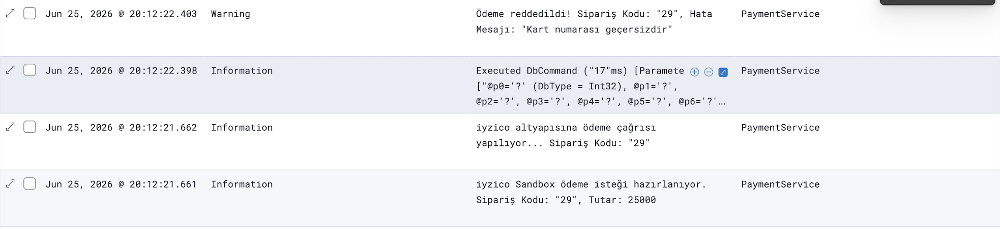
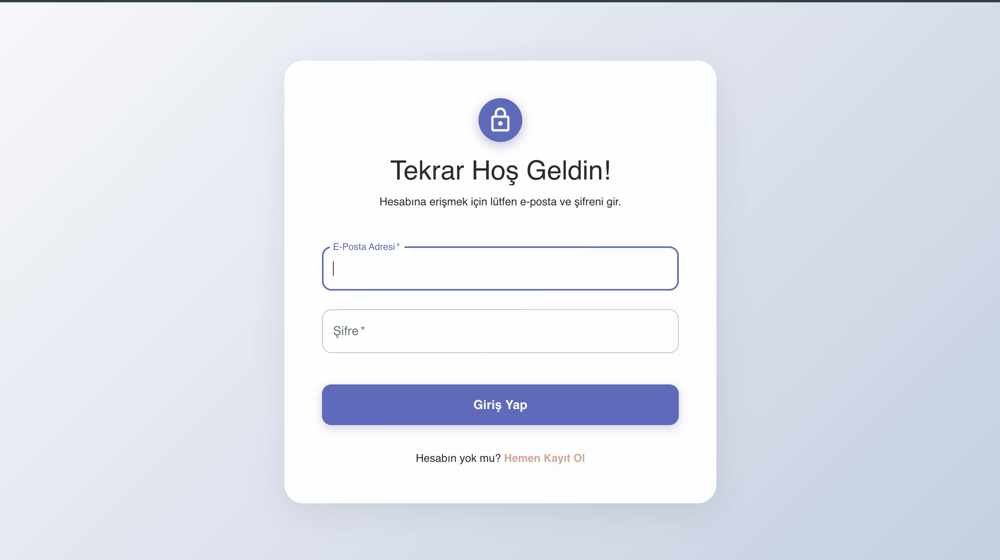
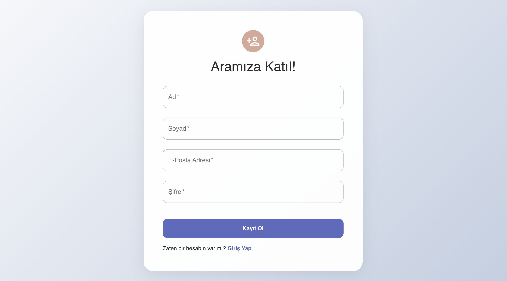
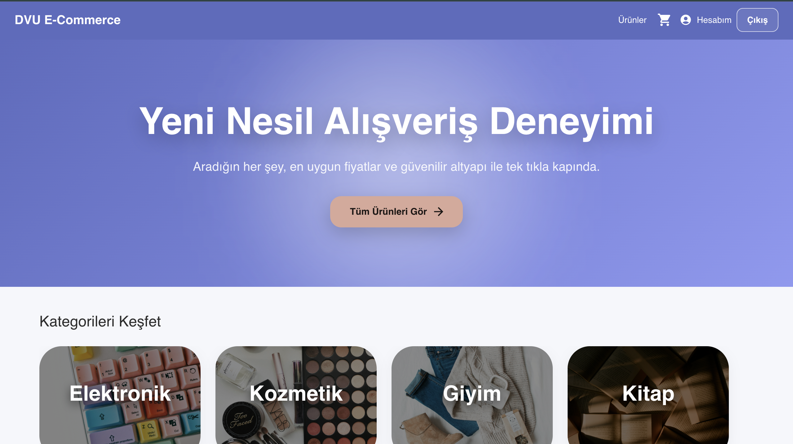
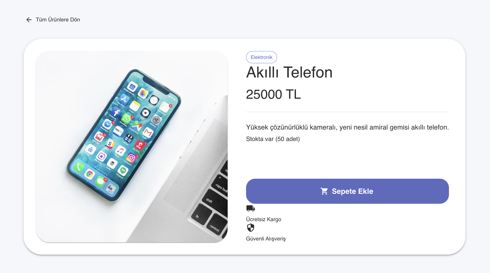
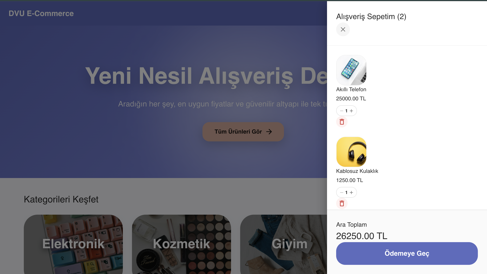
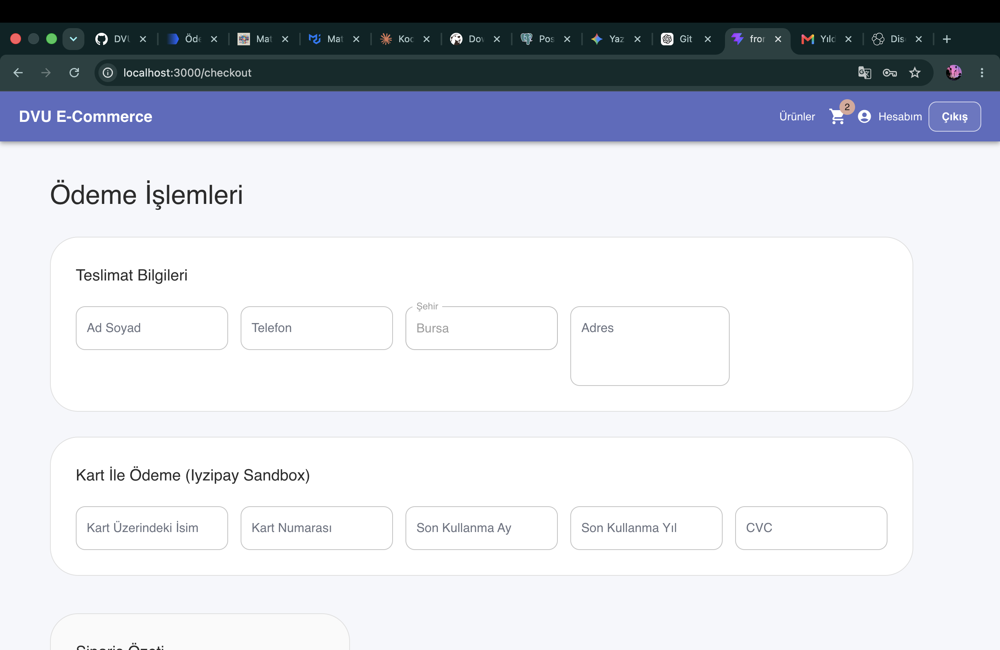
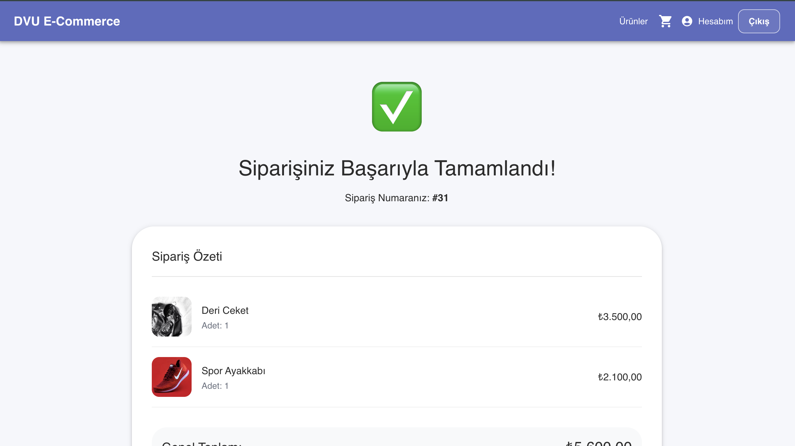
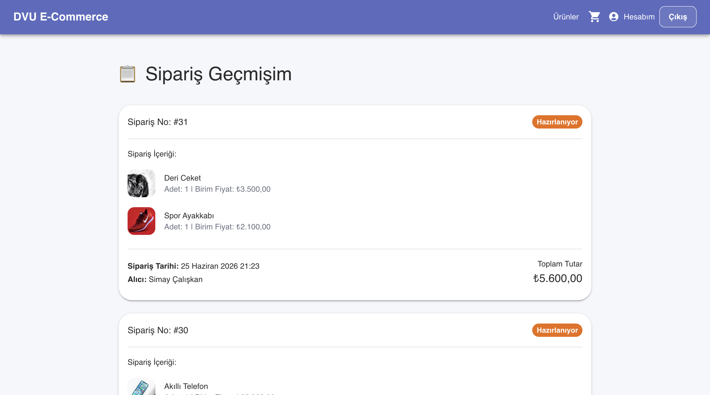

#  E-Commerce Microservices Project

Bu proje, modern yazılım mimarisi prensiplerine uygun olarak geliştirilmiş, tam kapsamlı (Full-Stack) ve kapsayıcı (Containerized) bir e-ticaret mikroservis uygulamasıdır. Proje, API Gateway arkasında haberleşen bağımsız servislerden oluşmakta olup, uçtan uca Dockerize edilmiştir.

## Proje Hakkında
Sistem, kullanıcı kimlik doğrulamasından (Identity) sipariş (Order) ve sanal POS ödeme (Payment) adımlarına kadar bir e-ticaret platformunun temel yeteneklerini barındırır. Tüm servisler kendi veritabanlarını yönetir ve merkezi bir loglama mimarisi üzerinden izlenebilir durumdadır.

## Kullanılan Teknolojiler ve Mimari Özellikler
* **Frontend:** React.js, Material UI (MUI), Axios (Backend ile API iletişimi), React Toastify (Kullanıcı bildirimleri / ToastContainer)
* **Backend:** .NET (Web API)
* **API Gateway:** YARP  (Tüm dış isteklerin tek noktadan yönetimi)
* **Kimlik Doğrulama & Yetkilendirme:** JWT (JSON Web Token) tabanlı Identity Servisi
* **Veritabanı:** PostgreSQL
* **Veritabanı Yönetimi:** DBeaver
* **Ödeme Altyapısı:** iyzico Sandbox (Non-3D Secure)
* **Merkezi Loglama:** Serilog, Elasticsearch ve Kibana
* **Konteynerleştirme:** Docker & Docker Compose

## Container İsimleri ve Port Konfigürasyonları
Sistem ayağa kalktıktan sonra ilgili servislere aşağıdaki adreslerden erişebilirsiniz:

* **`dvu_frontend` (Frontend):** http://localhost:3000 (React tabanlı kullanıcı arayüzü)
* **`dvu_api_gateway` (API Gateway):** http://localhost:5000 (Mikroservislere açılan ana kapı)
* **`dvu_postgres` (PostgreSQL):** localhost:5432 (Servislerin veritabanı sunucusu)
* **`dvu_kibana`:** http://localhost:5601 (Merkezi log izleme ve filtreleme paneli)
* **`dvu_elasticsearch`:** localhost:9200 (Log verilerinin tutulduğu arama motoru)
* **`dvu_identity_service`:** Gateway üzerinden (Kullanıcı kayıt ve JWT doğrulama)
* **`dvu_product_service`:** Gateway üzerinden (Ürün katalog/kategorize yönetimi)
* **`dvu_basket_service`:** Gateway üzerinden (Sepet yönetimi - Postgres)
* **`dvu_order_service`:** Gateway üzerinden (Sipariş oluşturma ve durum takibi)
* **`dvu_payment_service`:** Gateway üzerinden (iyzico entegrasyonlu ödeme işlemleri)

## İzlenebilirlik ve Loglama
Sistemdeki kritik servisler (Örn: Identity, Basket Service, Order Service ve Payment Service) Serilog entegrasyonuna sahiptir.
* Atılan tüm başarılı/başarısız istekler, iyzico ödeme dönüşleri ve olası sistem hataları (Exceptions) Elasticsearch'e aktarılır.
* Kibana paneli (http://localhost:5601) üzerinden "Microservice" bazlı filtreleme yapılarak e-ticaret akışı anlık olarak izlenebilir.

<div align="center">
  
  
  
</div>

## Kurulum ve Çalıştırma
Projenin tamamı tek bir Docker Compose dosyası üzerinden ayağa kalkacak şekilde tasarlanmıştır.

1. Projeyi bilgisayarınıza klonlayın ve ana dizine geçiş yapın:
   ```bash
   git clone <https://github.com/simay224090/DVU-E-COMMERCE.git>
   cd <dvu-ecommerce>

   docker compose up -d


## Proje Ekran Görüntüleri
Aşağıda uygulamamızın çeşitli arayüzlerinden ekran görüntüleri yer almaktadır:

<div align="center">
  
  
  
  
  
  
  
  
</div>

---
**Geliştirici:** Simay Çalışkan | Bilgisayar Mühendisliği

## Geliştirici
Simay Çalışkan
Bilgisayar Mühendisliği
